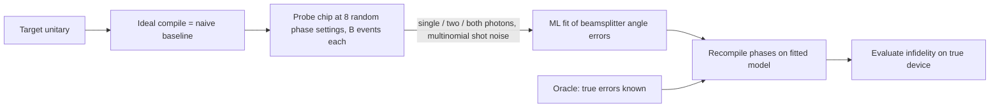
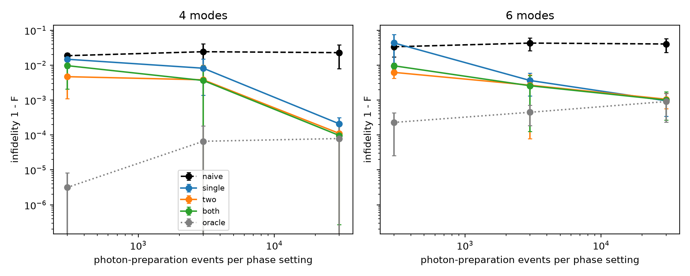
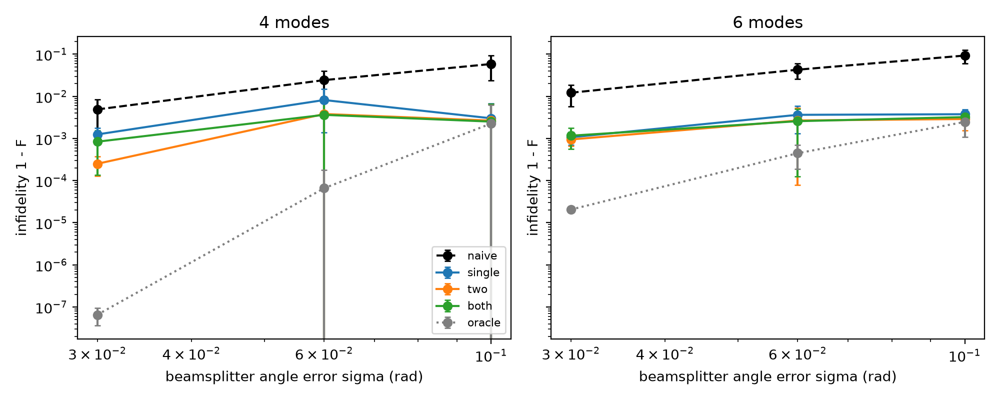
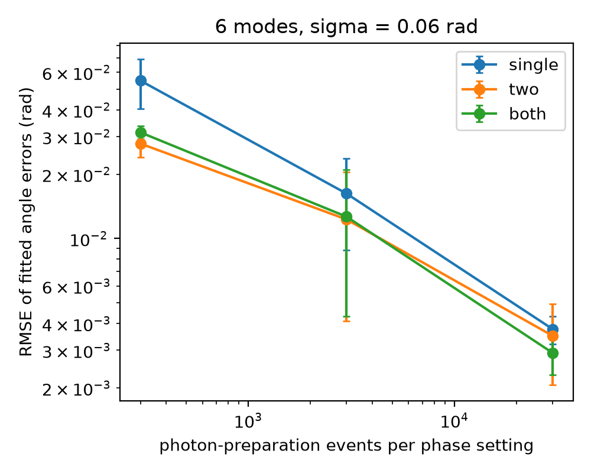

# Photon-budget-aware characterisation of imperfect photonic meshes

  

**Abstract.** Programmable Mach-Zehnder meshes never have exactly 50:50 beamsplitters, so an ideally compiled unitary loses fidelity. This simulation study asks which photon data best characterise those errors at a fixed photon-preparation budget: single-photon intensities or two-photon coincidences. In 4- and 6-mode meshes with shot noise, characterisation plus recompilation lowers infidelity by a median factor of about 12-27 over the naive compile, and two-photon data win in 27 of 30 paired cases, most clearly at small budgets.

## Motivation and research gap
Photonic quantum computing is moving to manufacturable, modular integrated platforms (Zhou et al., 2025, doi:10.1038/s41586-025-08820-7; Aghaee Rad et al., 2025, doi:10.1038/s41586-024-08406-9), and fusion-based architectures tolerate only a finite loss/error budget (Bartolucci et al., 2023, doi:10.1038/s41467-023-36493-1). Large programmable meshes underpin graph photonics and communication chips (Bao et al., 2023, doi:10.1038/s41566-023-01187-z; Luo et al., 2023, doi:10.1038/s41377-023-01173-8). The gap addressed here: which probe data to spend a finite measurement budget on when characterising a mesh. Hypothesis: at equal budget, two-photon statistics give lower post-recompilation infidelity than single-photon intensities. See [docs/RESEARCH_GAP.md](docs/RESEARCH_GAP.md) and [docs/METHOD.md](docs/METHOD.md).

## Method

Rectangular mesh, errors d ~ N(0, sigma²) on each beamsplitter angle, exact permanent-based one- and two-photon probabilities, differentiable in PyTorch. No photon loss is modelled.

## Results
Process infidelity 1 − F (mean ± std, 3 seeds; from `results/summary.csv`). "events/setting" is the total photon-preparation budget per phase setting.

| modes | sigma (rad) | events/setting | naive | single-photon | two-photon | both | oracle |
|---|---|---|---|---|---|---|---|
| 4 | 0.03 | 3000 | 4.9e-03 ± 3.6e-03 | 1.2e-03 ± 5.3e-04 | 2.5e-04 ± 1.2e-04 | 8.4e-04 ± 7.0e-04 | 6.5e-08 ± 2.9e-08 |
| 4 | 0.06 | 300 | 1.9e-02 ± 3.6e-03 | 1.5e-02 ± 6.7e-03 | 4.7e-03 ± 3.6e-03 | 9.7e-03 ± 7.6e-03 | 3.1e-06 ± 5.0e-06 |
| 4 | 0.06 | 3000 | 2.4e-02 ± 1.6e-02 | 8.2e-03 ± 6.8e-03 | 3.8e-03 ± 6.2e-03 | 3.6e-03 ± 6.1e-03 | 6.6e-05 ± 1.1e-04 |
| 4 | 0.06 | 30000 | 2.3e-02 ± 1.5e-02 | 2.1e-04 ± 1.0e-04 | 1.1e-04 ± 1.2e-04 | 9.7e-05 ± 9.7e-05 | 7.9e-05 ± 1.4e-04 |
| 4 | 0.10 | 3000 | 5.9e-02 ± 3.5e-02 | 3.0e-03 ± 3.7e-03 | 2.7e-03 ± 3.9e-03 | 2.5e-03 ± 4.1e-03 | 2.3e-03 ± 3.9e-03 |
| 6 | 0.03 | 3000 | 1.2e-02 ± 6.5e-03 | 1.1e-03 ± 3.7e-04 | 9.5e-04 ± 2.8e-04 | 1.2e-03 ± 6.1e-04 | 2.1e-05 ± 2.9e-06 |
| 6 | 0.06 | 300 | 3.4e-02 ± 1.7e-02 | 4.3e-02 ± 3.2e-02 | 6.2e-03 ± 2.1e-03 | 9.6e-03 ± 1.8e-03 | 2.3e-04 ± 2.0e-04 |
| 6 | 0.06 | 3000 | 4.3e-02 ± 1.7e-02 | 3.6e-03 ± 2.3e-03 | 2.7e-03 ± 2.6e-03 | 2.6e-03 ± 2.4e-03 | 4.5e-04 ± 2.6e-04 |
| 6 | 0.06 | 30000 | 4.0e-02 ± 1.7e-02 | 9.6e-04 ± 6.1e-04 | 1.1e-03 ± 4.9e-04 | 1.0e-03 ± 7.3e-04 | 9.1e-04 ± 6.8e-04 |
| 6 | 0.10 | 3000 | 9.3e-02 ± 3.2e-02 | 3.8e-03 ± 1.2e-03 | 2.9e-03 ± 1.4e-03 | 3.2e-03 ± 9.7e-04 | 2.5e-03 ± 1.4e-03 |

Paired statistics over the 30 (mode count, seed, condition) cases (`results/paired.json`): two-photon beats single-photon in 27/30 (6/6 at 300 events), single-photon beats naive in 27/30, two-photon beats naive in 30/30. Median infidelity relative to naive: 0.038 (two-photon), 0.083 (single-photon).





## Discussion
- The hypothesis is supported in this simulation, but the advantage is a small-budget effect: at 30000 events the two strategies are statistically indistinguishable (6 modes: 9.6e-04 ± 6.1e-04 vs 1.1e-03 ± 4.9e-04) and at 4 modes sigma = 0.10 the gap is well inside the error bars.
- Negative / caveat results: at 300 events and 6 modes single-photon recompilation (4.3e-02) is on average no better than the naive compile (3.4e-02); the "both" strategy, which splits the same budget, is not better than two-photon alone (e.g. 9.6e-03 vs 6.2e-03 at 300 events, 6 modes).
- At large budget, recompiled infidelity reaches the oracle level, so remaining error is limited by the 100-step recompilation optimiser (the oracle itself is 2.5e-03 at sigma = 0.10), not by characterisation.
- Std over only 3 seeds is large; the paired counts are suggestive, not a significance test.

## Limitations
Simulation only; no photon loss, partial distinguishability, detector inefficiency or phase-setting errors (phases assumed exact); only beamsplitter angles are fitted; 4 and 6 modes, 3 seeds, 8 phase settings; Haar-random targets; the optimiser budget limits the oracle. Photon-number-resolving detection is assumed.

## Future work
Add loss and imperfect HOM visibility to the fit; extend to larger meshes with the two-photon likelihood restricted to neighbouring input pairs; choose phase settings adaptively (experiment design); test on measured data from an integrated chip, where thermal crosstalk must also be fitted.

## Related work by the author
- [qfc-codesign-heterogeneous-quantum-links](https://github.com/pradeepdegalaroyal/qfc-codesign-heterogeneous-quantum-links): differentiable PyTorch link model for noise-aware photonic co-design.
- [modular-chip-aware-qaoa-placement](https://github.com/pradeepdegalaroyal/modular-chip-aware-qaoa-placement): noise-aware placement on modular devices.

## Reproducibility
```bash
pip install -r requirements.txt && pip install -e .
pytest -q
python experiments/run_all.py --quick   # smoke run, ~35 s
python experiments/run_all.py           # full run
```
Full run: 1365 s wall-clock (`results/runtime.json`), 3 worker processes x 2 threads, on Windows 11, Python 3.11.9, CPU only (16 threads machine, shared with other work). Note this exceeds a 15-minute budget I had aimed for.

## Structure
`src/photomesh/` (mesh, photon statistics, calibration) · `experiments/run_all.py` · `tests/` · `results/` (raw.csv, summary.csv, paired.json, table.md) · `figures/` · `docs/`

## Citation

If you use this code, please cite it (see also `CITATION.cff`):

```bibtex
@software{chenchupradeep2026photonicmesh,
  author  = {Chenchupradeep, Degala},
  title   = {photomesh: single- vs two-photon characterisation of imperfect photonic meshes},
  year    = {2026},
  version = {0.1.0},
  url     = {https://github.com/pradeepdegalaroyal/photonic-mesh-characterisation-photon-budget},
  license = {MIT}
}
```

MIT license (`LICENSE`).

## License
MIT
